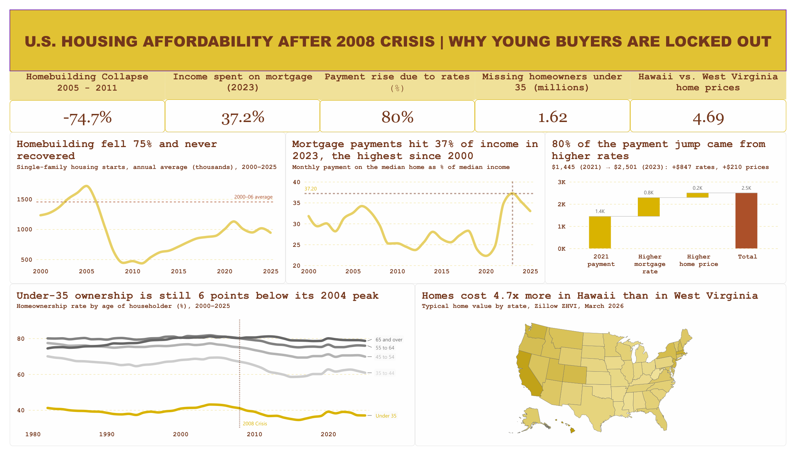

# U.S. Housing Affordability Crisis
### Why young buyers are locked out of homeownership after the 2008 crisis

**Tech stack:** Python (Pandas, Matplotlib) · Jupyter · Power BI



---

## Position

> The U.S. housing affordability crisis for first-time young buyers has two layers. The **structural layer**: homebuilding collapsed after 2008 and is still about 35% below its pre-crisis level, while real home prices rose 67% against only 11% growth in real household income. The **shock layer**: when mortgage rates more than doubled in 2022–2023, the monthly payment on a median home reached 37.2% of median income, the highest since at least 2000, and 80% of that jump came from higher rates. However, typical home values still differ 4.7x across states, so affordable states remain realistic entry points for first-time buyers today.

This is Part 2 of a series on financial pressures facing younger generations in the U.S. Part 1 showed that housing costs have outpaced income growth since 2007; this project explains why.

---

## Key Findings

| Question | Finding |
|---|---|
| Did homebuilding recover after 2008? | Single-family starts fell **74.7%** (1,718k in 2005 → 434k in 2011, annual averages) and in 2025 were still **35% below** the 2000–2006 average (942k vs 1,453k) |
| How affordable is buying a home? | The payment on the median home reached **37.2% of median household income in 2023**, the highest since 2000 (HUD cost-burden line: 30%) |
| Prices or rates: what drove the 2021 → 2023 shock? | The monthly payment rose **73%** ($1,445 → $2,501). A Shapley decomposition attributes **80% to higher rates** and 20% to higher prices |
| Is it just inflation? | 2000 → 2025: nominal home prices **+213%**, CPI +87%, so **real home prices +67%** vs **real median income +11%** |
| Who is locked out? | Under-35 homeownership fell from **43.1% (2004) to 37.0% (2025)**, a **6.1-percentage-point** drop. At the 2004 rate there would be **~1.6M more homeowners under 35** (upper-end estimate: 2004 was a credit-bubble peak) |
| Where is it still affordable? | Typical home values range from **$832k (Hawaii) to $177k (West Virginia)**, a **4.7x** gap. Most affordable: WV, MS, LA, OK, AR. Most expensive: HI, CA, MA, WA, DC |

*Payment assumptions: 10% down, 30-year fixed, principal and interest only.*

---

## Audit & Revisions

After the first version (May 2026), every number was re-checked against the raw data. Three corrections were made, and the evaluation refined the thesis.

| Issue | Version 1 | Corrected |
|---|---|---|
| **Aggregation bias** in state prices: an unweighted average of metro areas let many small, cheap metros outweigh large cities | Illinois ranked 3rd most affordable ($169k); 5x gap | Zillow's **state-level ZHVI** (every home weighted equally): Illinois ranks 17th ($293k); **4.7x** gap |
| **Mixed units** for housing starts: single months in the notebook, annual averages in the report | Peak 1,823k / trough 353k / −80.6% | **Annual averages** everywhere: 1,718k (2005) → 434k (2011), **−74.7%** |
| **Percent vs percentage points** in homeownership | "8.6% decline" (2004 → 2016) | **−6.1 percentage points** (2004 → 2025, latest data) |

The evaluation also showed that the long-run supply shortage explains the steady rise in real prices, but the **2022 affordability shock was mainly rate-driven** (80% of the payment increase). Version 1 is kept in [`archive/`](archive/).

---

## Methods

- **ETL pipeline (Python, Pandas):** 11 datasets from FRED, the U.S. Census Bureau and Zillow; weekly mortgage rates averaged to monthly, quarterly prices forward-filled, all series merged on date.
- **Mortgage amortization model:** fixed-rate payment formula on the median price at each year's average rate, divided by median household income.
- **Shapley decomposition:** the 2021 → 2023 payment change is computed changing price first, then rate first, and averaged, so the two effects add up exactly to the total.
- **Counterfactual analysis:** today's under-35 households × the 2004 ownership rate, minus today's owners.
- **Inflation adjustment:** prices and income deflated with CPI (index 2000 = 100).
- **State-level index:** Zillow state ZHVI instead of an unweighted average of metros.

---

## Dashboard

A single Power BI page that reads left to right as the argument: **cause → shock → why → who → where**. Each chart title states its finding.

| # | Chart | Finding |
|---|---|---|
| KPIs | Five cards | −74.7% homebuilding · 37.2% of income · 80% from rates · 1.6M missing homeowners · 4.7x state gap |
| 1 | Line + pre-crisis average | Homebuilding fell 75% and never recovered |
| 2 | Line | Mortgage payments hit 37% of income in 2023, the highest since 2000 |
| 3 | Waterfall | 80% of the payment jump came from higher rates |
| 4 | Line by age group | Under-35 ownership is still 6 points below its 2004 peak |
| 5 | Filled map | Homes cost 4.7x more in Hawaii than in West Virginia |

Open [`official_dashboard.pbix`](official_dashboard.pbix) in Power BI Desktop, or view [`official_dashboard.pdf`](official_dashboard.pdf). The DAX measures for the KPI cards are in [`powerbi_measures.dax.txt`](powerbi_measures.dax.txt).

---

## Repository Structure

```
us-housing-affordability-crisis/
│
├── validate.ipynb                 # Analysis notebook (v2): ETL, checks, evaluation, exports
├── official_dashboard.pbix / .pdf # One-page Power BI dashboard
├── powerbi_measures.dax.txt       # DAX measures used by the KPI cards
├── housing_position_report.docx   # Position report (revised Oct 2026)
├── images/dashboard.png           # Dashboard preview
│
├── orginal_dataset/   # Raw FRED, Census and Zillow (metro) files
├── fred_extra/        # CPI (CPIAUCSL) and median household income (MEHOINUSA646N)
├── zillow_state/      # Zillow state-level ZHVI
├── powerbi_data/      # Notebook outputs loaded into Power BI
├── clean_data/        # Outputs used by the version 1 dashboard
└── archive/           # Version 1: notebook with audit cells, dashboard, report
```

### Notebook outline (`validate.ipynb`)
| Section | What it does | Output (`powerbi_data/`) |
|---|---|---|
| 1. Setup & loading | Finds raw files in the repo folders, loads 8 FRED series | — |
| 2. ETL | Aligns weekly / quarterly / monthly data and merges | `housing_dashboard_data.csv` |
| 3. Supply | Housing-starts collapse (annual averages) | `housing_starts_annual.csv` |
| 4. Generation | Census Table 12 parsing, change in pp, counterfactual | `homeownership_by_age.csv`, `ownership_change.csv` |
| 5. Affordability | Payment, payment-to-income, price-to-income | `affordability_yearly.csv` |
| 6. Price vs rate | Shapley decomposition 2021 → 2023 | `payment_waterfall.csv` |
| 7. Inflation | Real (CPI-deflated) prices and income | in `affordability_yearly.csv` |
| 8. Geography | State ZHVI + aggregation-bias check | `state_home_values.csv` |
| 9. Summary | Headline numbers | `key_findings.csv` |

---

## How to Run

1. Clone this repository.
2. `pip install pandas openpyxl matplotlib jinja2`
3. Open `validate.ipynb` in Jupyter and choose **Restart & Run All**. The notebook finds the raw files in the repo folders and writes everything to `powerbi_data/`.

---

## Data Sources

| Source | Dataset |
|---|---|
| [FRED (Federal Reserve Bank of St. Louis)](https://fred.stlouisfed.org) | HOUST1F, ACTLISCOUUS, CSUSHPISA, MSPUS, MORTGAGE30US, MSACSR, CPIAUCSL, MEHOINUSA646N |
| [U.S. Census Bureau (CPS/HVS)](https://www.census.gov/housing/hvs/) | Historical Table 12: Households by Age of Householder, 1982–2025 |
| [Zillow Research](https://www.zillow.com/research/data/) | ZHVI, single-family + condo, mid tier (0.33–0.67), smoothed & seasonally adjusted: metro and state level |

---

## Limitations

- Mortgage payments include principal and interest only (no tax, insurance or PMI), so the true burden is higher.
- The missing-homeowner estimate uses 2004, a credit-bubble peak, as the baseline, so it is an upper-end estimate.
- The analysis is correlational: it shows the timing and size of changes, not proof of causation.
- The 4.7x gap compares the two extreme states and is sensitive to Hawaii (4.3x without it).

---

*Part of a two-project series on Financial Pressures Facing Younger Generations in the United States.*
